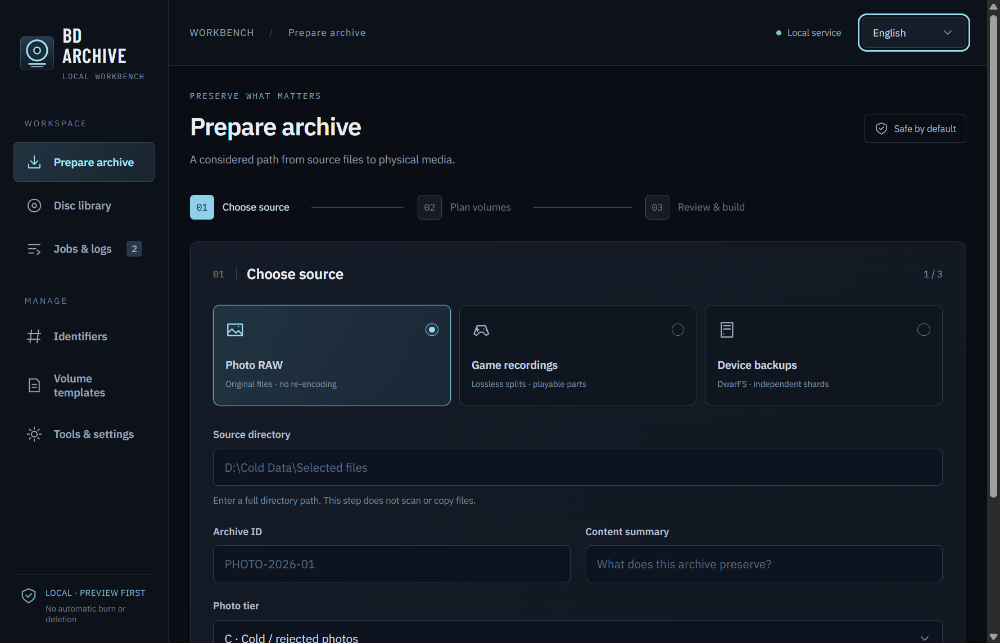

# BDArchive 0.3.0

**A local-first Windows workbench for Blu-ray cold archives.**

[简体中文](README.zh-CN.md) · [Download v0.3.0](https://github.com/sdy623/BDArchive/releases/tag/v0.3.0) · [Design](design.md) · [Operations](OPERATIONS.md)



## Install and launch

1. Download **BDArchive-0.3.0-windows-x64.zip** and `SHA256SUMS.txt` from the release. Check the ZIP with `Get-FileHash -Algorithm SHA256`.
2. Extract the **whole folder** to a writable location. Double-click **BDArchive.exe**. It opens a standalone WebView2 desktop window, not an external browser. The release's `START.bat` also prefers this EXE.
3. In **Tools & settings**, configure the archive working directory and required third-party tools. To reuse a library, select its directory, `catalog.json`, or `catalog.sqlite`, then **Inspect** → **Connect & load**.
4. Keep all bundled files; the EXE alone is not a portable application. Existing configurations and databases are not overwritten on startup.

Windows 10/11 x64, .NET Framework 4.7.2+ and Microsoft Edge WebView2 Runtime are required. PowerShell 7 is recommended for long paths; Windows PowerShell 5.1 supports basic operations with limitations. Python and the compiled React UI are included; users do not need Node or a separate Python installation. The launcher is **unsigned**, requests no administrator privileges and may show an unknown-publisher warning.

Use `BDArchive.exe --language en` or `--language zh-CN`. Third-party DwarFS, ImgBurn, PAR2, MKVToolNix, ffmpeg and WinFsp are **not bundled or installed automatically**. WinFsp is needed only for mounting. See [portable build instructions](packaging/PORTABLE.md) and [third-party notices](THIRD_PARTY_NOTICES.md).

## Three workflows

| Data | Approach |
|---|---|
| Photo RAW | Original files and RAW/JPEG/XMP families; optional exact-byte deduplication. No automatic photo culling. |
| Game recordings | Preserve the best existing master; losslessly split oversized videos with mkvmerge and optionally create contact sheets. |
| Old device / small-file backups | Plan independent shards before DwarFS 0.15.7 builds. Repeat root recovery metadata and check each image independently. |

Ingest → plan → build/stage → personally confirm one disc → optional physical readback → register. Source cleanup is a separate, explicitly authorized operation with verification gates. See [quick start](START-HERE.md), [scenarios](SCENARIOS.md) and [operations](OPERATIONS.md).

## Library and identifiers

- Fixed-height master/detail library: search disc ID, index, stored dates, summaries and retained filenames; filter and paginate records and per-disc content.
- `VERIFIED` is green; `BURNED_UNVERIFIED` is amber. Missing content indexes are explicitly unavailable, not an assertion that a disc is empty.
- Existing JSON is the full operation journal; SQLite is its query index. SQLite-only libraries are read-only and block archive workers. Connecting does not initialize, migrate or synchronize a database.
- The Identifiers page reads the actual P/G/B/M successors and global index from the existing locked numbering engine. Custom input is a draft; reading and previewing do not allocate or reset IDs.
- Physical disc IDs, archive-set IDs, logical volumes and filesystem labels are separate. NFC stores stable catalog URLs, never a tag UID as a business key.

## Safety boundaries

- Default preview / dry-run. Preparation never authorizes a physical burn.
- A real write requires explicit execution and the user personally entering **`BURN <disc_id>`**. No unattended batch approval.
- Simulation, staging, unverified writing and physical verification are distinct states. A test pass is not optical readback evidence.
- Deletion is not exposed by the React UI; guarded CLI cleanup requires its own explicit confirmation and eligibility checks. A/B-tier photos and core archives remain protected.
- Same-volume staging may use hard links: they are not independent backups, and deleting one filename may not free disk space.
- Archive/device locks prevent conflicting work. Closing is refused while a job runs or its state is unknown; idle shutdown stops only this app's backend.
- Password metadata records where a password is stored, never the password itself.

## Development

The source includes PowerShell scripts, BAT wrappers, SQLite schema, synthetic fixtures, React UI and native desktop host. No personal catalog, local configuration, media, execution log or private Git history is published.

```powershell
Copy-Item archive.config.example.json archive.config.json
cd ui
npm ci
npm run test:identifiers
npm run build
cd ..
python -m unittest discover -s tests -p 'test_*.py' -v
./tests/run-tests.ps1 -Python (Get-Command python).Source
python scripts/check-public-export.py
```

Source development needs Node 22.12+ and Python 3.10+. With no compiled EXE present, `START.bat` is the browser-based development entry. `START-LEGACY.bat` explicitly selects the compatibility UI. Build the native EXE using [packaging/PORTABLE.md](packaging/PORTABLE.md); do not distribute the developer browser launcher as the desktop app.

Public numbering starts at **0.3.0**. Some detailed engine notes retain pre-public 1.x implementation labels; those are not published release versions. Archive schema versions and stored disc identities are unchanged.

## Current limits

Dark theme only; light theme is not implemented in 0.3.0. Advanced maintenance remains CLI/legacy-only; React restore currently exposes preview. DwarFS contents are not automatically extracted by the catalog browser. No telemetry or automatic tool installation. [Validation](VALIDATION.md) separates synthetic, UI and hardware acceptance.

[Design](design.md) · [IDs](IDENTIFIERS.md) · [Burning](BURNING.md) · [Concurrency](CONCURRENCY.md) · [Fast builds](FAST-BUILD.md) · [Recovery / operations](OPERATIONS.md) · [Changelog](CHANGELOG.md)

## License

[MIT](LICENSE). The KMD-inspired design retains its upstream MIT notice. Offline fonts retain their SIL Open Font Licenses, and bundled Python/WebView2 runtime components retain their own notices. The BDArchive application icon is original project artwork. See [THIRD_PARTY_NOTICES.md](THIRD_PARTY_NOTICES.md).
