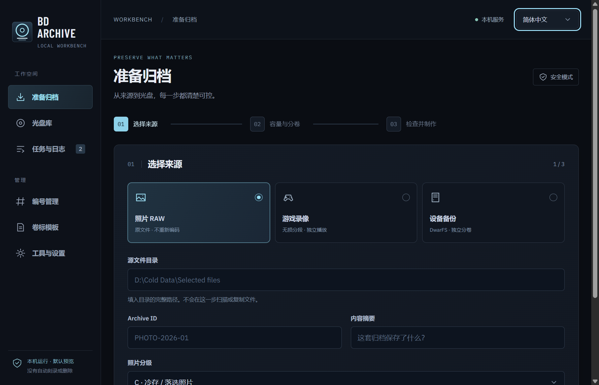

# BDArchive 0.3.0

**在 Windows 上分级、制作、校验和管理 BD 冷归档的本地工作台。**

[English](README.md) · [下载 v0.3.0](https://github.com/sdy623/BDArchive/releases/tag/v0.3.0) · [视觉设计](design.md) · [完整操作](OPERATIONS.md)



## 下载与启动

1. 在 Release 下载 **BDArchive-0.3.0-windows-x64.zip** 和 `SHA256SUMS.txt`，用 `Get-FileHash -Algorithm SHA256` 核对 ZIP。
2. **完整解压**到可写目录，双击 **BDArchive.exe**。这是独立 WebView2 桌面窗口，不会打开外部浏览器；发行包的 `START.bat` 也优先启动 EXE。
3. 在「工具与设置」配置工作盘和工具。已有光盘库可选择目录、`catalog.json` 或 `catalog.sqlite`，先「检查已有库」，再「连接并载入」。
4. 不要只复制 EXE；保留 runtime、ui、scripts、catalog、assets 和 DLL。启动不覆盖已有配置或重建数据库。

要求 Windows 10/11 x64、.NET Framework 4.7.2+、Microsoft Edge WebView2 Runtime。推荐 PowerShell 7；Windows PowerShell 5.1 可做基础操作，但长路径等有兼容限制。已内置 Python 和编译后的前端，不必安装 Node 或另装 Python。EXE **未签名**，可能显示未知发布者；不要求管理员权限。

语言：`BDArchive.exe --language zh-CN` / `--language en`。DwarFS、ImgBurn、PAR2、MKVToolNix、ffmpeg、WinFsp **不捆绑、不自动安装**；WinFsp 仅挂载时需要。详见 [桌面包说明](packaging/PORTABLE.md) 与 [第三方许可](THIRD_PARTY_NOTICES.md)。

## 三类场景

| 类型 | 归档方式 |
|---|---|
| 照片 RAW | 保留原文件、RAW/JPEG/XMP 家族；可选完全相同文件去重，不自动挑选废片。 |
| 游戏录像 | 保留现存最高质量母版；超大文件用 mkvmerge 无重编码切分，可生成联系表。 |
| 旧设备与小文件备份 | 先分独立 shard，再用 DwarFS 0.15.7 构建；重复根恢复 metadata，每个镜像独立检查。 |

最短流程：**配置 → ingest → plan → build/stage → 逐盘确认 burn → 可选实体回读 verify → register → 单独授权的可选源文件删除**。见 [快速开始](START-HERE.md)、[场景](SCENARIOS.md) 和 [操作规程](OPERATIONS.md)。PAR2、文件系统与安全余量都计入容量，25 GB 不等于 25 GiB。

## 光盘库、内容与编号

- 左侧列表可按盘号、索引、日期、摘要和保留文件名搜索，按状态/类别/日期筛选与分页；右侧查看所选光盘的内容和操作。
- `VERIFIED` 为绿色；`BURNED_UNVERIFIED` 为琥珀色，不能混称已校验。缺少内容索引会明确提示，不视为空盘。
- JSON 是完整操作记录，SQLite 是查询索引；只有 SQLite 时只读显示并禁止归档 worker。连接不会初始化、迁移、复制或同步数据库。
- 编号页读取库中真实 P/G/B/M 后继和全局索引；自定义值标记为草稿。读取/预览不占号、不重置，实际分配沿用加锁后端。
- 物理盘号、Archive Set、逻辑卷号、文件系统卷标分别管理；NFC 只存稳定 URL，不把标签 UID 当主键。

## 安全边界

- 默认预览 / dry-run。制作完成不等于授权刻盘。
- 真实写入须用户逐盘亲自输入 **`BURN <disc_id>`**，不能无人值守代确认。
- 模拟、待刻、未验证写入、实体校验是不同状态；测试通过不代表光盘回读通过。
- React 界面不提供源文件删除；受限 CLI 清理仍需独立确认和校验资格。A/B 层照片与核心数据受保护。
- 同卷 staging 可使用硬链接，不是独立副本；删除一个名字不一定释放空间。
- 归档/光驱锁避免冲突。任务运行或状态未知时禁止直接关闭；空闲退出只停止本程序的后台。
- 密码元数据只记保管位置，不存密码。

## 开发与限制

源码包含 PowerShell、BAT、SQLite schema、合成测试、React 前端和原生窗口宿主；不含私人库、配置、媒体、运行日志或旧私有 Git 历史。开发需 Node 22.12+、Python 3.10+ 和 PowerShell：

```powershell
Copy-Item archive.config.example.json archive.config.json
cd ui
npm ci
npm run test:identifiers
npm run build
cd ..
python -m unittest discover -s tests -p 'test_*.py' -v
./tests/run-tests.ps1 -Python (Get-Command python).Source
python scripts/check-public-export.py
```

源码目录没有 EXE 时，`START.bat` 是浏览器开发入口；`START-LEGACY.bat` 是兼容旧界面。原生 EXE 构建见 [packaging/PORTABLE.md](packaging/PORTABLE.md)。

公开版本从 **0.3.0** 开始；详细引擎文档中保留的 1.x 为公开前内部阶段编号，不是当前发布版本。版本重置不改变归档 schema 或旧盘号。

当前仅深色主题；0.3.0 尚无浅色主题。高级维护为 CLI/旧界面操作，React 恢复仅提供预览；目录浏览不会自动解开 DwarFS。无遥测、无自动工具安装。测试与硬件验收边界见 [VALIDATION.md](VALIDATION.md)。

[设计](design.md) · [编号](IDENTIFIERS.md) · [刻录](BURNING.md) · [并发](CONCURRENCY.md) · [快速构建](FAST-BUILD.md) · [更新记录](CHANGELOG.md)

## 许可

[MIT](LICENSE)。KMD 衍生设计保留上游声明；离线字体、Python 与 WebView2 组件保留各自许可。BDArchive 图标为本项目原创。见 [第三方说明](THIRD_PARTY_NOTICES.md)。
